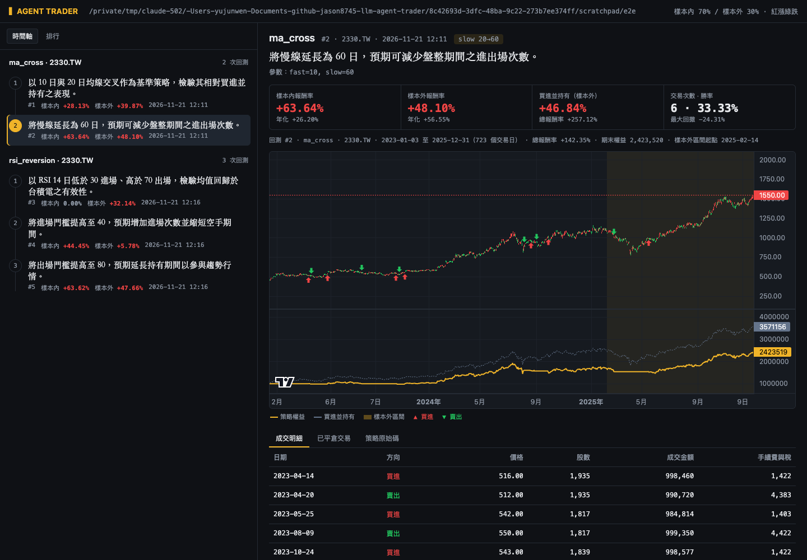

# LLM Agent Trader


A Taiwan stock backtesting harness for coding agents. You discuss a strategy with Claude Code, Claude writes it as a small Python file, and a deterministic engine backtests it. Every backtest has two explicit periods, a development period (策略開發期間) for designing and tuning the strategy and a later execution period (策略執行期間) that simulates running it live, each next to buy-and-hold, so you can tell a real edge from a curve fit.

Claude Code is the brain. This project is the hands: Taiwan market data, MCP tools, the backtest engine, the profit module, and a read-only dashboard. No LLM runs inside the backtest loop, and you do not need an LLM API key.



## How it works


1. You describe a strategy idea to Claude Code.
2. Claude writes `strategies/<name>.py` in your project folder.
3. Claude calls the `run_backtest` MCP tool. The engine runs the strategy on daily bars from Yahoo Finance and saves the result in `.trader/runs.db`.
4. Claude reports the numbers and a dashboard link. Every number comes from the engine, not from the model.

Interactive version of the diagram: [docs/v2/architecture.html](docs/v2/architecture.html).

## Install

Run these steps once, in order. Each step ends with a check. Do not continue until the check passes.

### 1. Install uv

uv runs the Python side of this project. It also downloads Python 3.12 for you, so you do not need to install Python yourself.

```bash
# macOS or Linux
curl -LsSf https://astral.sh/uv/install.sh | sh

# Windows (PowerShell)
powershell -ExecutionPolicy ByPass -c "irm https://astral.sh/uv/install.ps1 | iex"
```

Homebrew users can run `brew install uv` instead. Open a new terminal afterwards, then check:

```bash
uv --version
```

### 2. Install Claude Code

```bash
# macOS or Linux
curl -fsSL https://claude.ai/install.sh | bash

# Windows (PowerShell)
irm https://claude.ai/install.ps1 | iex
```

Homebrew users can run `brew install --cask claude-code` instead. Then run `claude` once and log in. Check:

```bash
claude --version
```

### 3. Install the plugin

```bash
claude plugin marketplace add jason8745/llm-agent-trader
claude plugin install llm-agent-trader@llm-agent-trader
```

The plugin adds the `trader` MCP tools and the research skill that tells Claude how to use them. Check:

```bash
claude mcp list
```

The output must include this line:

```
plugin:llm-agent-trader:trader: uv run --no-project --python >=3.9 .../mcp_launcher.py - ✔ Connected
```

If Claude Code was already open during the install, restart it or run `/reload-plugins` in it.

The first time a `trader` tool runs, uv downloads the Python libraries the engine needs (pandas, numpy, yfinance, about 50 MB). That first call takes one to a few minutes, depending on your network. Later calls take a few seconds.

## Use

### 1. Start Claude Code in a project folder

```bash
mkdir my-research && cd my-research
claude
```

Your strategies (`strategies/`) and backtest results (`.trader/runs.db`) are saved in this folder. Use one folder per research topic.

### 2. Let Claude guide you (first time)

Type this in Claude Code:

```
/llm-agent-trader:start
```

You can also say 「第一次使用，請帶我開始」. Claude checks that the tools work, explains where your strategies and results are saved, opens the dashboard in your browser, explains the research flow, and suggests example requests.

### 3. Describe what you want to study

For example:

> 我想研究台積電的趨勢追蹤策略。請使用 2023-01-01 至 2025-12-31 的資料，設計一個均線類策略並回測，至少迭代兩次，最後告訴我結論。

Claude asks for permission before it writes a file or calls a `trader` tool. Approve these requests. Claude then:

1. Looks up the symbol (`search_stock("台積電")` returns `2330.TW`).
2. Writes `strategies/<name>.py`.
3. Confirms the symbol, strategy, both periods, cash and fees with you, then calls `run_backtest` with a stated hypothesis for each iteration and tunes on the development period only.
4. Picks the final backtest, stores a conclusion with `finalize_study` (every number in it must appear in the tool output), and reports it with a dashboard link.

A full real session is in [docs/v2/evidence/pr7/claude-session.md](docs/v2/evidence/pr7/claude-session.md).

### 4. Open the dashboard

Ask Claude 「打開 dashboard」 at any time, and it opens the dashboard in your browser. Each backtest reply also ends with a link, for example `http://127.0.0.1:8765/runs/1`. The port is 8765 unless another project's dashboard already uses it, so prefer the link Claude gives you.

Keep the dashboard open next to Claude Code. Each new backtest appears within a few seconds without a reload, and the page switches to it. If you open an older backtest, the page stays on it and only the list updates.

The dashboard lists every study in this folder by stock. A study is one symbol, one strategy file and both periods; its page shows every iteration and the stored conclusion. Each backtest shows the hypothesis, the metrics of both periods next to buy-and-hold, the market regimes, a candlestick chart with buy and sell markers, profit and drawdown curves, the fills, the closed trades, and the strategy source.

The dashboard stops when Claude Code exits. Next time, start Claude Code in the same folder and ask it to open the dashboard again. Without Claude Code, run this in the project folder:

```bash
uvx --from git+https://github.com/jason8745/llm-agent-trader llm-agent-trader ui
```

It prints the address, for example `http://127.0.0.1:8765/`. Open it in a browser. Press Ctrl+C to stop it.

## Update and uninstall

```bash
claude plugin marketplace update llm-agent-trader
claude plugin update llm-agent-trader@llm-agent-trader

claude plugin uninstall llm-agent-trader@llm-agent-trader
claude plugin marketplace remove llm-agent-trader
```

Uninstalling leaves your project folders untouched, including `strategies/` and `.trader/`.

## Strategy contract

```python
"""ma_cross: hold while the 10-day SMA is above the 20-day SMA, long only."""

from trader import ta

PARAMS = {"fast": 10, "slow": 20}


def on_bar(hist, pos, p):
    fast = ta.sma(hist.close, p["fast"]).iloc[-1]
    slow = ta.sma(hist.close, p["slow"]).iloc[-1]
    return 1.0 if fast > slow else 0.0
```

- `hist` holds the bars up to and including today: `open, high, low, close, volume, dividend`. The strategy cannot see tomorrow. In the execution period `hist` also holds the earlier bars, so indicators are already warmed up.
- The return value is the target position, from 0.0 to 1.0. It fills at the next day's open, and the position changes only when the returned target changes.
- `trader.ta` provides `sma`, `ema`, `rsi`, `macd`, `bbands`, and `atr` with TA-Lib conventions. Indicators compose, for example `ta.ema(ta.rsi(hist.close, 14), 5)`.

## How the numbers are computed

- **Fees (Taiwan).** Commission is 0.1425% on both sides with a NT$20 minimum. Sell tax is 0.3% for stocks and 0.1% for ETFs. Both are floored to whole NT$. Other markets default to zero fees.
- **Dividends.** Prices are split-adjusted, not dividend-adjusted. Cash dividends are credited on the ex-date, so an ex-dividend drop is not counted as a loss.
- **Two periods.** The development period runs on its own bars only. The execution period starts flat with the initial cash at the first trading day on or after its start date; the strategy may use every earlier loaded bar as history. Buy-and-hold is computed for each period the same way, and each period's returns are measured against the initial cash.
- **⚑ overfit flag.** It shows when the annualized development return exceeds the annualized execution return by more than 15 points.
- **Market regimes.** The closes of all loaded bars are split by fixed rules into up, down and range legs, and the strategy's return and time in the market are reported per leg.
- **One formatter.** Every number shown by the tools, the CLI, and the dashboard comes from `trader.profit` and is rendered by `trader.fmt`. Tests enforce identical strings across all three.

Full definitions are in [docs/v2/design.md](docs/v2/design.md) section 4.

## CLI

The same features work without Claude Code. Run these in a project folder, prefixed with `uvx --from git+https://github.com/jason8745/llm-agent-trader`:

```bash
llm-agent-trader search 台積電
llm-agent-trader backtest ma_cross 2330.TW 2023-01-01 2024-12-31 2025-01-01 2025-12-31 --hypothesis "..."
llm-agent-trader runs
llm-agent-trader show 1
llm-agent-trader ui
llm-agent-trader mcp
```

`backtest` reads `strategies/ma_cross.py` from the current folder. The four dates are the development start and end, then the execution start and end.

## Development

```bash
git clone https://github.com/jason8745/llm-agent-trader && cd llm-agent-trader
uv sync
uv run pytest                      # TRADER_LIVE=1 also hits yfinance
scripts/mutation_check.sh          # plants known engine bugs; each must fail the suite
uv run --with ta-lib --with numpy python tests/fixtures/gen_talib_reference.py
uv run python scripts/build_stock_list.py
```

To try local changes in Claude Code, start it with `claude --plugin-dir .` from the repo root.

- Decision log for the v2 build: [docs/v2/decisions.tsv](docs/v2/decisions.tsv)
- v1 (an LLM-endpoint backtester) is archived on the [`archive/v1`](https://github.com/jason8745/llm-agent-trader/tree/archive/v1) branch and the `v1` tag.

## License

MIT. The dashboard bundles [TradingView Lightweight Charts](https://github.com/tradingview/lightweight-charts) 5.2.1 under the Apache License 2.0 (`src/trader/viewer/lightweight-charts.LICENSE`).
