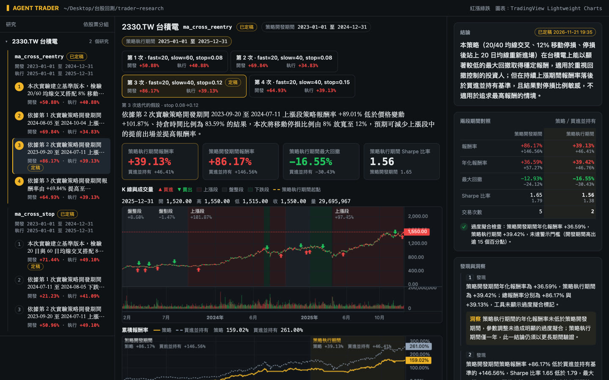
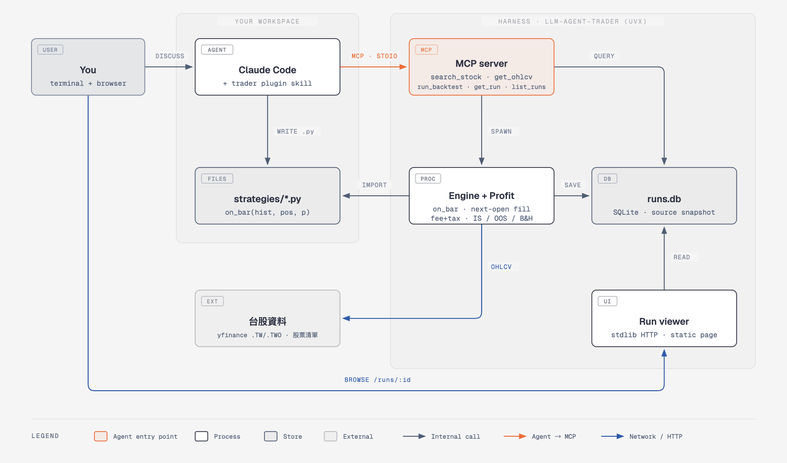

# 台股回測 LLM Agent Trader

用聊天的方式研究台股策略。你說出想法，Claude 撰寫策略、回測、解讀結果，並在 dashboard 上即時呈現。每一個數字都由確定性的回測引擎計算，Claude 只負責討論與解讀，不自行計算。

不需要寫程式，也不需要 API key。安裝好 Claude Desktop 之後，下載一個檔案、點兩下就能開始。

*English summary at the [end of this page](#english).*

https://github.com/user-attachments/assets/302b4b27-0123-4f33-9b11-6b6c69221360

影片為一次真實的 Claude Code 操作：說「開始使用台股回測」、用選項卡片確認條件、用自己的話加上停損，Claude 自動實驗並定稿，dashboard 同步呈現結果。

## 特色

- **兩段期間，直接看出過度擬合。** 每次回測都分成「策略開發期間」（用來設計與調整策略）與「策略執行期間」（模擬策略定稿後實際執行，不參與調整），兩段都與「買進並持有」並列比較。
- **點選就能操作。** 需要你決定的地方，例如建立資料夾、選研究主題、確認標的與策略與期間，Claude 會用選項卡片詢問，點選即可，不需要打字。
- **結論有發現，也有洞察。** 定稿時，Claude 寫入一句總結與數組「發現與洞察」，涵蓋過度擬合、與買進並持有比較、盤勢（上漲段、盤整段、下跌段）與統計可信度。結論中的每個數字都會由程式驗證。
- **dashboard 即時更新。** 以圖表為主，Claude 每完成一次回測，頁面幾秒內自動更新。
- **台股資料內建。** 上市、上櫃股票與 ETF 共 2,324 檔，可以用中文名稱查詢，台股手續費與證交稅已內建。

## 安裝

選擇一種方式即可。不會用終端機的話，請選方法一。

### 方法一：Claude Desktop（不需要終端機）

1. 安裝並登入 [Claude Desktop](https://claude.ai/download)。
2. 到 [Releases 頁面](https://github.com/jason8745/llm-agent-trader/releases/latest)，下載最新的 `llm-agent-trader-x.y.z.mcpb`。
3. 點兩下下載的檔案，或把它拖進 Claude Desktop 視窗，在跳出的視窗按「安裝」。
4. 開一個新對話，輸入：

   ```
   開始使用台股回測
   ```

不需要另外安裝 Python 或其他軟體，Claude Desktop 會自動準備執行環境。第一次回測時，系統會下載回測引擎需要的元件，可能需要一至數分鐘；之後每次回測只要幾秒。

### 方法二：Claude Code

適合已經在使用 [Claude Code](https://code.claude.com) 的人。

1. 安裝 [uv](https://docs.astral.sh/uv/)（已安裝可略過，用 `uv --version` 確認）：
   - macOS、Linux：`curl -LsSf https://astral.sh/uv/install.sh | sh`
   - Windows（PowerShell）：`powershell -ExecutionPolicy ByPass -c "irm https://astral.sh/uv/install.ps1 | iex"`

   安裝後請重新開啟終端機。
2. 安裝 plugin：

   ```bash
   claude plugin marketplace add jason8745/llm-agent-trader
   claude plugin install llm-agent-trader@llm-agent-trader
   ```

3. 在任何資料夾啟動 `claude`，輸入 `/llm-agent-trader:start`，或直接說「開始使用台股回測」。

## 第一次使用

說「開始使用台股回測」之後，Claude 會依序：

1. **徵求同意建立研究資料夾。** 位置是「文件 › trader-research」，用來存放策略檔與回測紀錄。點選「建立研究資料夾」後才會建立，只會問這一次。
2. **開啟 dashboard。** 瀏覽器會自動開啟；沒有開啟時，點 Claude 回覆中的網址即可。
3. **請你選擇研究主題。** 選項卡片會列出三個範例；也可以選「我有自己的想法」，用一句話說明標的與策略，例如：

   > 我想研究台積電的均線趨勢策略，期間 2023 到 2025 年。

   > 用 0050 測試 RSI 超賣進場、超買出場。

   沒有提到的條件，Claude 會先提出建議，下一步再請你確認。

## 一次研究的流程

1. **確認五項研究條件。** Claude 會列出五項建議，再用選項卡片請你選擇「全部採用」或要修改的項目；選擇修改時，會再列出具體選項讓你點選：
   1. 標的，例如 `2330.TW 台積電`。
   2. 策略邏輯與初始參數。
   3. 策略開發期間：用來設計與調整策略。
   4. 策略執行期間：較晚的一段期間，模擬策略定稿後實際執行，以初始資金重新開始，不參與任何調整。預設為最後 12 個月。
   5. 初始資金與費用：預設新臺幣 1,000,000 元與台股手續費、證交稅。
2. **自動實驗。** 確認之後，Claude 會自己撰寫策略並連續做三到五次實驗，中途不再詢問。每次只改變一個條件，並寫明根據上一次結果提出的假設。調整只依據策略開發期間的結果；策略執行期間的結果每次都會顯示，用來檢驗策略在沒參與調整的期間是否仍然有效。想自己決定每一步的話，跟 Claude 說「每次實驗後先停下來問我」。
3. **自動定稿。** 實驗完成後，Claude 選出策略開發期間表現最好的一次，寫入一句總結與數組「發現與洞察」：發現是有數字的事實，洞察說明這代表什麼、原因或下一步。最後附上實驗紀錄表，並用選項卡片提出延伸研究的方向。

### 隨時調整

- **確認條件時**：選「修改策略」「修改期間」或「修改標的或資金」，再點選具體選項；選項裡沒有的，選「Type something.」（Claude Desktop 為「其他」）直接打字，例如「均線交叉 20/60，再加上 8% 停損」。
- **定稿之後**：點選延伸研究的選項，或直接說出想法，例如「把停損改成 12% 再研究一次」「換成聯發科試試看」。標的、策略或期間改變時會成為新的研究，dashboard 左側會多一筆。
- **想看某一次結果**：說「打開第 3 次回測」，或在 dashboard 左側點選。

## 看懂 dashboard



- **左側：研究清單。** 依股票分組。一個「研究」是一檔股票、一個策略與兩段期間，底下列出每一次迭代。
- **中間：圖表。** 上方是迭代切換、這次的假設與四個重點數字，下面是三張同步的圖：
  - **K 線與成交量**：含買賣點、盤勢分段（上漲段紅、盤整段灰、下跌段綠）與策略執行期間起點。
  - **累積報酬率**：策略與買進並持有的比較。策略執行期間以初始資金重新開始，所以曲線接在策略開發期間的終點往下畫；策略執行期間內曲線的漲跌幅，就等於策略執行期間的報酬率。
  - **回撤**：策略從高點回落的幅度。
  - 滑鼠移到圖上會顯示當天的數值。下方抽屜可展開成交明細、已平倉交易、最深回撤、盤勢分段表與策略原始碼。
- **右側：結論。** 一句總結、兩段期間對照與過度擬合檢查、發現與洞察、各盤勢的表現。

dashboard 會跟著 Claude 的回測自動更新，不需要重新整理。之後想再打開，對 Claude 說「打開 dashboard」即可。

## 研究資料夾

所有研究都存放在同一個資料夾，預設是「文件 › trader-research」（`~/Documents/trader-research`）：

- `strategies/`：策略檔。
- `.trader/runs.db`：回測紀錄與結論。

刪除這個資料夾就會刪除所有研究。Claude Code 使用者可以用環境變數 `TRADER_WORKSPACE` 改放其他位置。

## 常見問題

**第一次回測為什麼比較久？** 第一次會下載回測引擎需要的元件（約 50 MB），視網路狀況需要一至數分鐘，之後只要幾秒。

**dashboard 沒有自動打開？** 點 Claude 回覆中 `http://127.0.0.1:8765/` 開頭的網址。

**Claude 說「研究資料夾尚未建立」？** 這是在等你同意，點選「建立研究資料夾」，或回覆「同意」即可。

**如何更新？** Claude Desktop：下載新版的 `.mcpb` 再安裝一次。Claude Code：執行 `claude plugin marketplace update llm-agent-trader` 與 `claude plugin update llm-agent-trader@llm-agent-trader`，再重新啟動 Claude Code。

**如何移除？** Claude Desktop：在設定的擴充功能中移除。Claude Code：執行 `claude plugin uninstall llm-agent-trader@llm-agent-trader`。研究資料夾不會被刪除。

**支援哪些股票？** 台灣上市、上櫃股票與 ETF 的日 K 資料，來源為 Yahoo Finance。只做多，以整股計算。

**這是投資建議嗎？** 不是。回測結果只反映歷史資料，不代表未來績效。

## 運作方式



Claude 只負責討論、撰寫策略與解讀結果；回測在本機的子行程中執行，迴圈內不呼叫 LLM。launcher 只用 Python 標準函式庫，第一次對話就能立即回應研究規則並建立資料夾，同時在背景以 uv 準備回測引擎。

## 數字怎麼計算

- **費用（台股）。** 手續費買賣各 0.1425%，最低新臺幣 20 元；證交稅股票 0.3%、ETF 0.1%；皆元以下捨去。
- **股利。** 價格只做分割調整，不做股利調整；現金股利於除息日入帳，所以除息造成的價格下跌不會被算成虧損。
- **成交。** 當天收盤產生訊號，隔一個交易日開盤成交。
- **兩段期間。** 策略開發期間只使用自己的資料。策略執行期間從起日當天或之後的第一個交易日開始，以初始資金、空手開始，策略可以使用之前的資料計算指標。買進並持有在兩段期間以相同方式計算，報酬率都相對於初始資金。
- **⚑ 過度擬合警示。** 策略開發期間的年化報酬率較策略執行期間高出逾 15 個百分點時顯示。
- **盤勢分段。** 依固定規則分段：價格在 12% 區間內來回達 60 個交易日以上為盤整段；其餘期間以反轉 10% 判斷轉折，漲幅達 15% 為上漲段、跌幅達 15% 為下跌段，其餘為盤整段。
- **單一格式化來源。** 工具、CLI 與 dashboard 顯示的每個數字都由 `trader.profit` 計算、`trader.fmt` 格式化，測試確保三處字串完全相同。

完整定義見 [docs/v2/design.md](docs/v2/design.md) 第 4 節。

## 策略的寫法

Claude 會替你撰寫策略，以下供想自己修改的人參考：

```python
"""ma_cross：10 日均線高於 20 日均線時持有，僅做多。"""

from trader import ta

PARAMS = {"fast": 10, "slow": 20}


def on_bar(hist, pos, p):
    fast = ta.sma(hist.close, p["fast"]).iloc[-1]
    slow = ta.sma(hist.close, p["slow"]).iloc[-1]
    return 1.0 if fast > slow else 0.0
```

- `hist`：截至當天收盤的日 K（`open, high, low, close, volume, dividend`），看不到未來的資料。
- 回傳值是目標持倉比例（0.0 至 1.0），隔一個交易日開盤成交，只有回傳值改變時才調整部位。
- `trader.ta` 提供 `sma`、`ema`、`rsi`、`macd`、`bbands`、`atr`，慣例與 TA-Lib 一致，可以互相組合，例如 `ta.ema(ta.rsi(hist.close, 14), 5)`。

## 進階：命令列

不透過 Claude 也能使用，指令作用在研究資料夾（需已建立；需要 uv）：

```bash
uvx --from git+https://github.com/jason8745/llm-agent-trader llm-agent-trader search 台積電
uvx --from git+https://github.com/jason8745/llm-agent-trader llm-agent-trader backtest ma_cross 2330.TW 2023-01-01 2024-12-31 2025-01-01 2025-12-31 --hypothesis "..."
uvx --from git+https://github.com/jason8745/llm-agent-trader llm-agent-trader ui
```

其他指令：`runs`（列出回測）、`show <編號>`（顯示一次回測）、`mcp`（啟動 MCP server）。

## 開發

```bash
git clone https://github.com/jason8745/llm-agent-trader && cd llm-agent-trader
uv sync
uv run pytest                         # TRADER_LIVE=1 會實際連線 yfinance
scripts/mutation_check.sh             # 植入已知錯誤，每一個都必須讓測試失敗
uv run python scripts/build_mcpb.py   # 產生 Claude Desktop 安裝檔 dist/*.mcpb
uv run python scripts/gen_mcp_manifest.py
uv run python scripts/build_stock_list.py
```

- 在 Claude Code 中試用本地修改：在 repo 根目錄執行 `claude --plugin-dir .`。
- 研究流程與規則只有一份：`src/trader/guide.md`，由 MCP 工具 `get_research_guide` 提供給 Claude Desktop 與 Claude Code。
- 設計文件：[docs/v2/design.md](docs/v2/design.md)；決策紀錄：[docs/v2/decisions.tsv](docs/v2/decisions.tsv)。
- v1（呼叫 LLM endpoint 的回測器）封存在 [`archive/v1`](https://github.com/jason8745/llm-agent-trader/tree/archive/v1) 分支與 `v1` tag。

## English

A Taiwan stock backtesting harness for Claude. You discuss a strategy in chat; Claude writes it, backtests it on a deterministic engine, and explains the result on a live dashboard. Every number is computed by the engine, never by the model. Each backtest has a development period for tuning and a later execution period that simulates live use, both compared with buy-and-hold, so overfitting is visible. Conclusions are stored as a verdict plus findings paired with insights, and every number in them is verified against the tool output.

Demo video (40 s, real session): see the top of this page.

Install: in Claude Desktop, download the `.mcpb` from [Releases](https://github.com/jason8745/llm-agent-trader/releases/latest) and double-click it, then say 「開始使用台股回測」. In Claude Code: `claude plugin marketplace add jason8745/llm-agent-trader` and `claude plugin install llm-agent-trader@llm-agent-trader`.

## 授權

MIT。dashboard 內含 [TradingView Lightweight Charts](https://github.com/tradingview/lightweight-charts) 5.2.1，採 Apache License 2.0（`src/trader/viewer/lightweight-charts.LICENSE`）。
