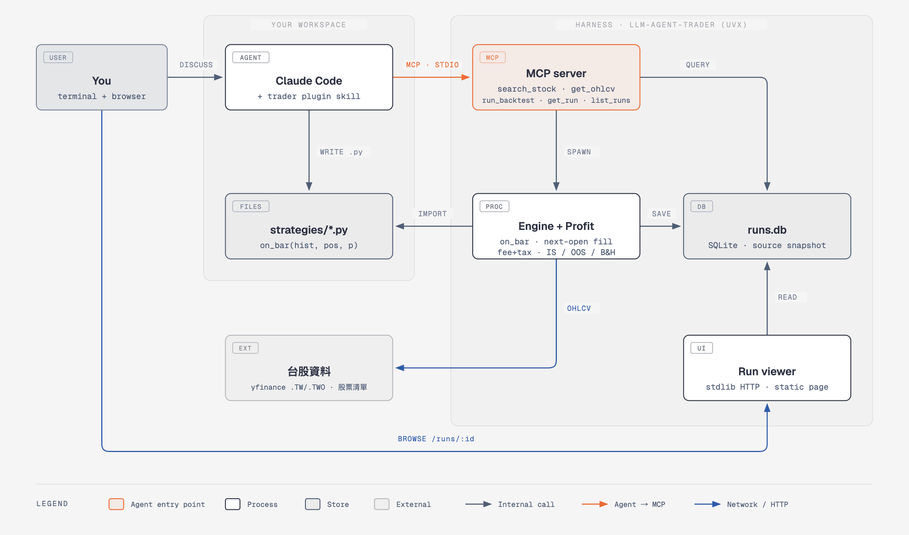

# llm-agent-trader v2 設計文件

> 狀態：已實作（2.4.x）。本文件描述目前的設計；逐項決策的時間與理由見 [`decisions.tsv`](decisions.tsv)。



## 1. 定位

**Claude 是大腦，v2 是手。**

v2 是一套 code harness，將台股資料、MCP tools、回測引擎（Engine）與損益模組（Profit）串接起來。使用者在 Claude Desktop 或 Claude Code 與 Claude 討論交易策略後，由 Claude 撰寫策略程式碼，並直接在 harness 上回測。回測迴圈內不呼叫任何 LLM。

v1 的做法是由後端呼叫 LLM endpoint，在每個觸發事件上請模型做出買賣決策。v2 改為 agent 負責「撰寫策略」，引擎負責「確定性地執行」，與 WrenAI 中 LLM 產生宣告、引擎負責執行的分工一致。

## 2. 與 v1 的差異

v1 由後端在每根 K 棒呼叫 LLM 做買賣決策（`llm_strategy.py` 共 3501 行），回測慢、成本高、不可重現，且有模型記憶歷史行情的洩漏風險。v2 刪除這些程式，回測迴圈內不使用 LLM；保留並移植撮合與績效計算、指標、資料抓取與 lightweight-charts 圖表。v1 封存於 `archive/v1` 分支與 `v1` tag。

## 3. 決策紀錄

| # | 決策 | 定案 |
|---|---|---|
| Q1 | Agent 角色 | 策略作者兼分析師；回測迴圈內不使用 LLM |
| Q2 | 整合介面 | MCP server（stdio），同一套函式另提供 CLI |
| Q3 | Web UI | 唯讀 dashboard；對話在 Claude Desktop 或 Claude Code 內進行 |
| Q4 | 目標使用者 | 包含不會使用終端機的使用者；不需另設 LLM API key |
| Q5 | 過渡方式 | v1 封存於 `archive/v1` 分支與 `v1` tag；master 經由逐一 PR 改為 v2，每個 PR 附驗證證據（PR 內文以 commit 連結引用） |
| Q6 | 市場範圍 | 單一標的、日 K |
| Q7 | 策略格式 | Python 檔，事件驅動 `on_bar(hist, pos, p) -> 目標持倉比例 0–1` |
| Q8 | 策略與結果存放 | 單一研究資料夾（第 5 節）：策略存放於 `strategies/*.py`；每次回測存入 SQLite，含策略原始碼快照與 hash |
| Q9 | 策略執行 | 每次回測開一個 subprocess，設 timeout；不另做安全沙箱 |
| Q10 | MCP tools | 見 4.2；指標以 Python 函式庫 `trader.ta` 提供 |
| Q11 | 發佈 | Claude Desktop 以 `.mcpb` 擴充套件、Claude Code 以 plugin 發佈，皆由 uv 準備 Python 與依賴；不發佈至 PyPI。dashboard 為標準函式庫 HTTP server 加靜態頁面，lightweight-charts 5.2.1 隨套件發佈 |
| Q12 | 回測期間 | 每次回測只有一段回測期間，一律附買進並持有基準；起日前 60 個交易日作為指標暖機（4.4）。2.3–2.4 版曾分為策略開發期間與策略執行期間，2.5.0 取消，見 decisions.tsv |
| Q13 | 研究規則 | 只有一份 `src/trader/guide.md`，由 `get_research_guide` 提供；Claude Code 的 skill 只指向它（4.7） |
| Q14 | `hypothesis` | `run_backtest` 必填，說明本次驗證的假設 |
| Q15 | dashboard 頁面 | 研究頁與回測頁；每 2 秒輪詢更新，不使用 SSE；不做多回測對比頁 |
| Q16 | 撮合規則 | 收盤產生訊號、次一交易日開盤成交；只做多；整數股；不模擬滑價 |
| Q17 | 策略參數 | 模組層 `PARAMS`，可由 `run_backtest(params=...)` 覆寫；不提供參數掃描 tool |
| Q18 | 台股代號搜尋 | `search_stock` 以內建台股清單（TWSE/TPEx）依中文名稱或代號查詢 |
| Q19 | 市場預設 | 以台股為主，任何 yfinance 代號皆可回測；台股以外的標的費用預設為 0 |
| Q20 | 漲跌配色 | 固定紅漲綠跌 |
| Q21 | dashboard 版面 | 左欄依股票分組的研究清單、中間圖表（重點數字在上）、右欄結論（4.6） |
| Q22 | 圖表 | lightweight-charts v5；K 線與成交量、累積報酬率、回撤三張同步圖表 |
| Q23 | 數字正確性 | 所有數字由程式計算並經測試驗證；顯示格式集中於單一 formatter；LLM 不得自行計算或改寫數字 |
| Q24 | LLM 用語 | 所有解釋使用正式書面語，遵循 skill 內的術語表 |

## 4. 系統組成

架構圖見文件開頭。回測在子行程中執行並設 timeout，策略只能取得截至當日收盤的資料。

### 4.1 策略契約

```python
# strategies/ma_cross.py
"""ma_cross：均線黃金交叉，僅做多。"""
from trader import ta

PARAMS = {"fast": 10, "slow": 20}

def on_bar(hist, pos, p):
    # hist：截至當日收盤（含）的歷史資料；不可能取得未來資料
    # pos：目前持倉比例
    # 回傳：目標持倉比例，範圍 0.0–1.0
    fast = ta.sma(hist.close, p["fast"]).iloc[-1]
    slow = ta.sma(hist.close, p["slow"]).iloc[-1]
    return 1.0 if fast > slow else 0.0
```

- 指標資料不足時（暖機期），由策略自行處理 NaN；引擎將非有限值或超出 0–1 的回傳值視為錯誤並終止該次 run。
- 組合指標可寫成 `trader.ta` 內的函式供所有策略共用，或寫在單一策略檔內。

### 4.2 MCP tools

| Tool | 輸入 | 輸出 |
|---|---|---|
| `get_research_guide` | — | 研究流程、詢問方式、數字與用語規範，以及研究資料夾是否已建立（由 launcher 直接回應） |
| `setup_workspace` | — | 在使用者同意後建立研究資料夾（由 launcher 直接回應） |
| `save_strategy` | `name, code` | 靜態檢查（語法、`on_bar` 三個參數、`PARAMS`）後寫入 `strategies/<name>.py` |
| `search_stock` | `query`（中文名稱或代號） | 符合的代號、名稱、市場別（上市／上櫃） |
| `get_ohlcv` | `symbol, start, end` | 日 K 資料（經本地快取） |
| `run_backtest` | `strategy, symbol, start, end, hypothesis, params?, cash?, fee?` | 回測編號、研究代碼與迭代次數、策略與買進並持有的指標表、交易統計、盤勢彙總與分段表、檢視器網址 |
| `get_run` | `run_id` | `run_backtest` 的內容，加上最深回撤、成交明細、已平倉交易、資料指紋與原始碼快照 |
| `list_runs` | `strategy?, symbol?` | 依研究分組的回測列表：迭代次數、報酬率、買進並持有、最大回撤與定稿標記 |
| `finalize_study` | `run_id, verdict, findings` | 將該回測標記為所屬研究的定稿，寫入一句總結與 3–6 組「發現與洞察」；數字驗證未通過時拒絕寫入並列出數字 |
| `open_dashboard` | `run_id?` | 啟動並開啟檢視器 |

研究（study）由標的、策略檔、回測起日與迄日共四個值組成；四個值相同的回測屬於同一研究，研究代碼為 `sha1("symbol|strategy|start|end")` 的前 12 個十六進位字元。

### 4.3 撮合與費用

- 第 t 日收盤後呼叫 `on_bar`，目標部位於第 t+1 日開盤價成交。
- 只有當 `on_bar` 回傳的目標持倉比例與前一次不同時才調整部位；比例不變時不因價格變動而再平衡，避免每日微量交易。
- 目標股數為 floor(目標比例 × 開盤時權益 ÷ 開盤價)；買進時若現金不足以支付成交金額與手續費，買進可負擔的最大股數。
- 除息日（yfinance 的 `Dividends`）以前一日收盤持股數計入現金股利；股利所得稅與二代健保補充保費不在模擬範圍內。
- 只做多，持股為整數股（允許零股，不強制以 1000 股為單位）。
- 台股預設費用（`.TW`／`.TWO`）：
  - 手續費：成交金額 × 0.1425%，買賣皆收；未滿新臺幣 20 元以 20 元計；元以下無條件捨去。
  - 證券交易稅：賣出時收取，股票 0.3%、ETF（代號 00 開頭）0.1%；元以下無條件捨去。債券 ETF 的免稅優惠不在預設範圍內，可由 `fee` 覆寫。
  - 以上費率可由 `run_backtest(fee=...)` 覆寫。
- 其他市場預設費用為 0。

### 4.4 績效定義（Profit 模組）

每次回測只有一段回測期間（`start`–`end`）：

- 載入 `start` 前 130 個日曆天至 `end` 的 K 棒，保留 `start` 之前最後 60 根（`WARMUP_BARS`）作為指標暖機。`simulate(K 棒, start=k)`，k 為日期不早於 `start` 的第一根 K 棒；以初始本金空手開始，第 k−1 日收盤的決策於第 k 日開盤成交。暖機 K 棒只顯示在 K 線圖上，不成交、不計入任何指標。
- 驗證：日期為 ISO 格式，且 `start ≤ end`；回測期間至少 2 個交易日。
- 買進並持有基準於第 k 日開盤買進。

設回測期間的權益序列為 E[0..n-1]，初始本金為 C。

| 指標 | 定義 |
|---|---|
| 權益 E[t] | 現金[t] + 持股數[t] × 收盤價[t] |
| 總報酬率 | E[n-1] / C − 1 |
| 年化報酬率 | (1 + 總報酬率)^(365.25 ÷ 首末日日曆天數) − 1；天數為 0 時顯示「—」 |
| 期末權益 | E[n-1] |
| 最大回撤 | min(E[t] / 截至 t 的最高權益 − 1)，最高權益自 C 起算，以負值表示 |
| 最大回撤期間 | 最大回撤的高點日至低點日 |
| 回撤回復交易日 | 最大回撤自高點至回到高點的交易日數；未回到高點時顯示「尚未回復」 |
| 日報酬率 | r_0 = E[0] / C − 1，r_t = E[t] / E[t−1] − 1 |
| 年化波動率 | 日報酬率樣本標準差 × √252 |
| Sharpe 比率（無風險利率 0） | 日報酬率平均 ÷ 樣本標準差 × √252 |
| Calmar 比率 | 年化報酬率 ÷ |最大回撤| |
| 交易次數 | 該段期間內已平倉的完整來回次數；期末未平倉部位不計 |
| 勝率 | 已實現損益 > 0 的平倉次數 ÷ 交易次數 |
| 平均獲利／平均虧損 | 獲利交易平均損益 ÷ |虧損交易平均損益| |
| 獲利因子 | 獲利交易損益合計 ÷ |虧損交易損益合計| |
| 單筆最大獲利／虧損 | 平倉交易損益的最大值／最小值 |
| 平均持有交易日 | 平倉交易出場與進場相隔交易日數的平均 |
| 持倉時間比例 | 收盤持股數 > 0 的交易日 ÷ 該段交易日數 |
| 最深回撤 | 依幅度列出最深的 5 次回撤：高點、低點、幅度、回復日（或「尚未回復」）與交易日數 |

**盤勢分段**：對回測期間 K 棒的收盤價依固定規則分段：價格在 12% 區間內來回達 60 個交易日以上為盤整段；其餘期間以反轉 10% 判斷轉折，漲幅達 15% 為上漲段、跌幅達 15% 為下跌段，其餘為盤整段。每段計算價格變動、策略報酬率（逐日報酬率連乘）與持倉時間比例。**盤勢彙總**依上漲、盤整、下跌三類各一列：段數、交易日合計、各段價格變動與策略報酬率連乘、依交易日加權的持倉時間比例。

**結論驗證**：`finalize_study` 以與 `scripts/check_transcript.py` 相同的規則擷取結論中的數字（`[+-]?\d[\d,]*(?:\.\d+)?%?`，忽略單一位數的數字，忽略緊接「年」的四位數年份），每個數字（或去掉開頭 `+` 的寫法）都必須出現在同一研究所有回測的 `get_run` 輸出中（不含原始碼快照）。任一數字不符即拒絕寫入並列出所有不符的數字；重新定稿會覆寫前一次的結果。

指標慣例與 TA-Lib 一致：回看期間未滿時為 NaN；EMA 以前 n 筆的簡單平均作為種子；RSI 與 ATR 使用 Wilder 平滑；MACD 的快線 EMA 種子與慢線對齊；布林通道使用母體標準差。`tests/fixtures/talib_reference.json` 由 TA-Lib 產生，作為參考值。

### 4.5 顯示格式（單一 formatter）

| 類型 | 格式 | 範例 |
|---|---|---|
| 報酬率、回撤、價格變動、盤勢策略報酬率 | 百分比，小數 2 位，正值帶 `+` | `+12.34%`、`-6.70%` |
| 波動率、勝率、持倉時間比例 | 百分比，小數 2 位，不帶正負號 | `45.00%` |
| Sharpe、Calmar、平均獲利／平均虧損、獲利因子、平均持有交易日 | 小數 2 位 | `1.29` |
| 金額 | 新臺幣整數，千分位 | `1,275,227` |
| 單筆損益 | 新臺幣整數，千分位，正值帶 `+` | `+12,345`、`-1,234` |
| 價格 | 小數 2 位，千分位 | `1,070.00` |
| 股數、次數、交易日數 | 整數，千分位 | `2,031` |
| 期間 | `YYYY-MM-DD 至 YYYY-MM-DD` | `2024-07-11 至 2024-08-05` |
| 無值 | 破折號 | `—` |

標的一律顯示為代號加中文名稱（例如 `2330.TW 台積電`）。資料一律以完整精度儲存，只在顯示時捨入。檢視器、MCP 回傳的文字、CLI 共用同一套格式函式（`trader.fmt`），測試確保三者字串一致。

### 4.6 檢視器

- 左欄依標的分組列出研究，研究內依序列出各次迭代與定稿標記。
- 研究頁（`/studies/<key>`）：研究問題、各次迭代的參數差異與績效摘要、定稿結論。
- 回測頁（`/runs/<id>`）：策略與買進並持有的指標表、交易統計、最深回撤、盤勢彙總與分段、K 線（含暖機 K 棒）與買賣標記、累積報酬率與回撤曲線、成交明細與策略原始碼。
- JSON API：`/api/info`、`/api/tree`、`/api/studies/<key>`、`/api/runs/<id>`；所有顯示值皆為 `trader.fmt` 產生的字串，僅圖表陣列為原始數值。
- 紅漲綠跌。

### 4.7 研究流程與用語

規則只有一份：[`src/trader/guide.md`](../../src/trader/guide.md)，由 `get_research_guide` 提供給 Claude Desktop 與 Claude Code。內容包括：以選項卡片詢問使用者、徵求同意建立研究資料夾、確認四項研究條件、自動完成三至五次實驗（每次只改一個條件並寫明假設），結論固定包含參數敏感度、自動定稿、報告格式，以及數字規範（每個數字照錄工具輸出，不自行計算）與正式書面語的術語表。`scripts/check_transcript.py` 依同一套規則檢查對話紀錄。

## 5. 安裝與研究資料夾

- **對象**：包含不會使用終端機的使用者，因此同時支援 Claude Desktop 與 Claude Code。
- **Claude Desktop**：以 `.mcpb` 擴充套件安裝（`scripts/build_mcpb.py`），`server.type` 為 `uv`。Claude Desktop 會自行下載 uv，uv 再下載 Python 與依賴套件，使用者不需安裝任何軟體。
- **Claude Code**：維持 plugin 安裝。
- **研究資料夾**：只有一個，固定為 `~/Documents/trader-research`（`TRADER_WORKSPACE` 可覆寫，僅供 Claude Code 與測試；擴充套件不提供設定欄位，因為 Claude Desktop 的設定視窗不會展開 `${DOCUMENTS}` 且 Save 無法按下），不再依啟動位置判斷。資料夾只能由 `setup_workspace` 在使用者同意後建立；尚未建立時，其他工具一律回覆請先徵求同意，命令列也不會自行建立。
- **策略檔**：由 `save_strategy` 寫入並先做靜態檢查，因為 Claude Desktop 的對話沒有寫檔工具。
- **研究規則**：只有一份，即 `src/trader/guide.md`，由 `get_research_guide` 提供；skill 只負責指向它。
- **launcher**：直接回應 `get_research_guide` 與 `setup_workspace`（`trader/workspace.py` 只使用標準函式庫），使第一輪對話不必等待依賴套件安裝。launcher 以 `UV` 環境變數取得的同一個 uv 啟動真正的 server，並只使用 uv 管理的 Python，避免觸發 macOS 內建 Python 的開發者工具安裝提示。
